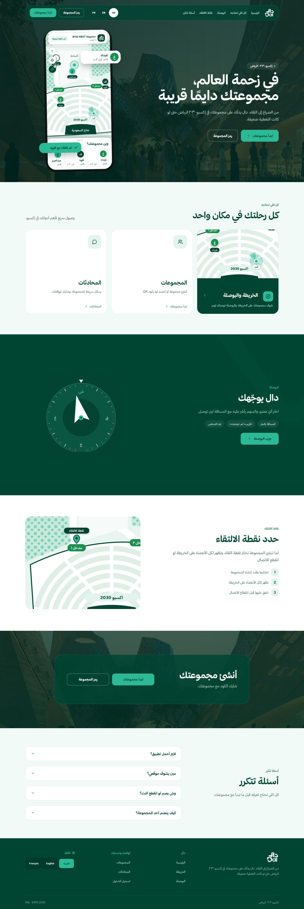

# دال | DAL

### مجموعتك دائمًا قريبة — A smarter way to reunite at Expo 2030 Riyadh

دال هو نموذج أولي (Prototype) لمنصة ويب تساعد زوار إكسبو 2030 الرياض على العثور على أفراد مجموعاتهم والالتقاء بهم في المساحات المزدحمة، مع مراعاة ضعف التغطية الخلوية. يجمع بين مشاركة الموقع بإذن المستخدم، والخريطة التفاعلية، والبوصلة، ونقطة لقاء مشتركة.

🔗 [تجربة دال مباشرة](https://dal.up.railway.app)



## التحدي الذي نعالجه

- البرنامج: تحدي إكسبو 2030 الرياض — برنامج Immersive.
- المسار: 1 — تجربة الزائر الذكية (Smart Visitor Experience).
- التحدي: 1.5 — صعوبة عودة الزائر إلى مجموعته عندما تكون نقطة اللقاء مزدحمة وإشارة الجوال ضعيفة.

بدلًا من الاعتماد على المكالمات وتبادل وصف المواقع يدويًا، يتيح دال لأعضاء المجموعة رؤية آخر موقع متاح لبعضهم، واختيار شخص أو نقطة لقاء والتوجّه نحوه. والهدف تقليل الوقت والارتباك اللازمين للالتقاء وتحسين تجربة الزائر.

## كيف يستخدم الزائر دال؟

1. يسجّل حسابًا، ثم ينشئ مجموعة أو ينضم إليها برمز دعوة أو رابط/QR.
2. يفعّل مشاركة الموقع ويمنح إذن GPS من المتصفح.
3. يرى أعضاء المجموعة ونقاطهم على الخريطة مع وقت آخر تحديث.
4. يختار أحد الأعضاء أو نقطة لقاء، ثم يستخدم طريق المشي أو البوصلة للتوجّه.
5. يتواصل عبر المحادثة أو التنبيهات، ويمكنه تأكيد اللقاء يدويًا عند الوصول.

## الوظائف

### Core / MVP

- إنشاء المجموعات والانضمام إليها وإدارة الأعضاء وصلاحيات الانضمام.
- مشاركة الموقع والتحكم في إيقافها واستئنافها.
- خريطة تفاعلية تعرض موقع المستخدم والأعضاء المسموح بعرض مواقعهم ونقطة اللقاء.
- بوصلة تعرض الاتجاه والمسافة المباشرة، مع دعم حساس اتجاه الجهاز عندما يتوفر.
- تعيين نقطة لقاء مشتركة وعرضها للمجموعة.

### ميزات إضافية (Extra)

- توجيه بالمشي عبر OpenRouteService مع مسار مرسوم على الخريطة، ومسافة ومدة من مزود الطرق عندما تكون متاحة.
- مساعد AI لشرح توصيات الالتقاء ومقارنة نقاط اللقاء المقترحة؛ يعتمد القرار على قواعد وحسابات في Backend، ويستخدم OpenAI للشرح عند تهيئته.
- محادثة جماعية ومحادثات خاصة وتنبيهات داخل النظام.
- رمز QR لدعوة الأعضاء، وتأكيد الوصول وإشعارات المجموعة.
- استعادة كلمة المرور بالبريد عند تهيئة Brevo.

### ماذا يحدث عند ضعف أو انقطاع الاتصال؟

دال ليس شبكة اتصال مستقلة، ولا يدّعي توفير تتبع مباشر دون إنترنت. عند تعذّر الاتصال، يمكن عرض آخر مواقع ونقطة لقاء كانت متاحة ومخزنة مؤقتًا في ذاكرة الصفحة، مع توضيح عمر البيانات، ثم استئناف المزامنة عندما يعود الاتصال. التحديثات المباشرة وإرسال الرسائل يتطلبان اتصالًا بالخادم. وقد تتعذر الخرائط الخارجية أو خدمة طريق المشي عند انقطاع الشبكة.

## التقنيات المستخدمة

| الطبقة | التقنية |
| --- | --- |
| Frontend | React 18, Vite 6, JavaScript, CSS |
| Maps & Navigation | React Leaflet, Leaflet, OpenStreetMap, Browser Geolocation & Device Orientation APIs |
| Backend | Java 17, Spring Boot 4.1.1, Spring Web, Spring Data JPA, Spring Security |
| Database | MySQL |
| Authentication & Security | HttpSession, CSRF protection, BCrypt, input validation, access controls |
| Walking Directions | OpenRouteService API (اختياري ويحتاج مفتاحًا) |
| AI Explanation | OpenAI Responses API (اختياري، مع بديل حسابي عند عدم توفره) |
| Email | Brevo API (عند التهيئة) |
| Deployment | Railway, Docker |

## بنية المستودع

```text
Dal/
├── frontend/                # React + Vite + واجهات الخريطة والبوصلة والمحادثات
│   ├── src/
│   ├── tests/
│   └── Dockerfile
├── backend/                 # Spring Boot REST API
│   ├── src/main/java/com/example/dal/
│   │   ├── Controller/
│   │   ├── Service/
│   │   ├── Repository/
│   │   ├── Model/
│   │   ├── DtoIn/
│   │   ├── DtoOut/
│   │   └── Config/
│   ├── src/test/
│   ├── migrations/
│   └── Dockerfile
├── docs/                    # نتائج اختبارات ولقطات مراجعة
├── RAILWAY_SETUP.md
└── README.md
```

الواجهة تطلب `/api/v1` عبر Reverse Proxy من نفس نطاق الموقع. يحتفظ Backend بالجلسة ويتحقق من CSRF والصلاحيات؛ لا توضع مفاتيح خدمات الطرف الثالث في React.

## أمثلة من API

كل المسارات التالية تحت `/api/v1` وتتطلب الجلسة/الصلاحيات المناسبة، وعمليات التعديل تستخدم CSRF:

| Method | Endpoint | الوظيفة |
| --- | --- | --- |
| `GET` | `/security/csrf` | الحصول على CSRF token |
| `POST` | `/navigation/group/{groupId}/walking` | حساب مسار مشي للعضو أو نقطة اللقاء |
| `POST` | `/navigation/group/{groupId}/reunion-assistance` | مساعدة اللقاء وشرح التوصية |
| `POST` | `/navigation/group/{groupId}/meeting-suggestions` | مقارنة مواقع اللقاء المقترحة |
| `GET` | `/notification/unread-count` | عدد التنبيهات غير المقروءة |
| `POST` | `/group-message/group/{groupId}` | إرسال رسالة للمجموعة |
| `GET` | `/group-message/group/{groupId}` | قراءة رسائل المجموعة |

## الاختبارات والتحقق

```bash
# Frontend (من داخل frontend/)
npm test
npm run build

# Backend (من داخل backend/ على Windows)
.\mvnw.cmd test
```

وفق [تقرير التحقق المحفوظ بتاريخ 13 أكتوبر 2026](docs/final-validation.json)، نجح 35 اختبار Frontend و46 اختبار Backend، إلى جانب بناء الواجهتين. تضمنت مراجعة المتصفح سيناريوهات ببيانات اصطناعية؛ لا تمثّل وحدها إثباتًا لاختبار جميع الأجهزة الحقيقية أو الشبكات الضعيفة.

## سيناريو عرض سريع أمام المحكّمين

1. افتح [دال](https://dal.up.railway.app) من جهازين أو متصفحين بحسابين مختلفين.
2. أنشئ مجموعة في الجهاز الأول، وشارك رمزها أو QR مع الثاني.
3. انضم من الجهاز الثاني، وفعّل مشاركة الموقع بعد الموافقة على الأذونات.
4. اعرض موقع العضو الآخر على الخريطة، ثم اختره للتوجيه بالمشي أو بالبوصلة.
5. اعرض نقطة اللقاء والمحادثة أو التنبيه، ووضّح كيف يُعرض آخر موقع معروف عند ضعف الاتصال.

## حدود النموذج الأولي

- يلزم اتصال بالإنترنت لمزامنة مواقع الأعضاء والرسائل؛ لا توجد مزامنة مباشرة بين أجهزة الزوار دون خادم.
- دقة GPS والبوصلة تعتمد على الجهاز والمتصفح والأذونات والبيئة المحيطة.
- بيانات OpenStreetMap وطرق المشي الخارجية ليست خريطة رسمية مكتملة لممرات معرض إكسبو 2030 أو الازدحام الفعلي؛ لا تُستخدم التوصيات كضمان للسلامة.
- خدمات ORS وOpenAI وBrevo تعتمد على مفاتيح وإعدادات المزودين، وقد لا تكون جميعها مفعلة في كل بيئة.
- هذا Prototype لإثبات جدوى الفكرة، وليس نظام ملاحة ميدانيًا معتمدًا.

## الأثر المتوقع

يساعد دال على تقليل الارتباك عند انفصال الزوار عن مجموعاتهم، وتبسيط الوصول إلى نقطة اللقاء، وإعطاء الزائر معلومات واضحة عن مواقع الأعضاء ومدى حداثتها، بما يخدم تجربة الزائر الذكية في إكسبو 2030 الرياض.

## ملفات توثيق إضافية

- [توثيق قاعدة بيانات محادثة المجموعة](backend/migrations/README.md)
- [نتائج التحقق الآلي](docs/final-validation.json)

### لقطات من النموذج

| التوجيه بالمشي | اقتراح نقطة اللقاء | المحادثة الجماعية |
| --- | --- | --- |
|  |  |  |

---

دال — Expo 2030 Riyadh Challenge · Prototype for challenge 1.5 (Smart Visitor Experience).
