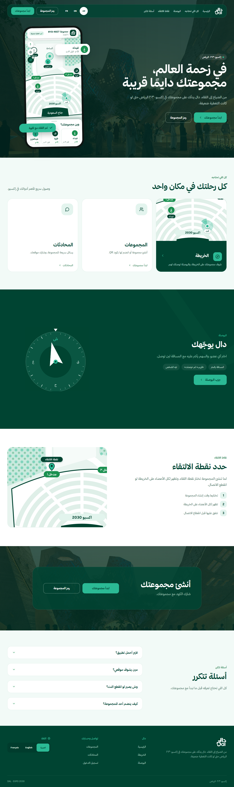
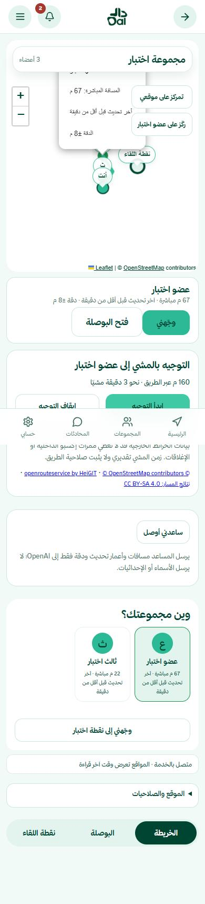
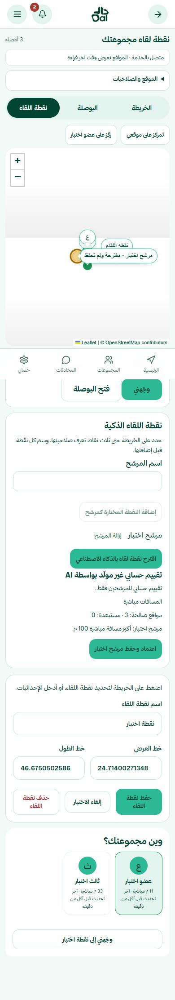
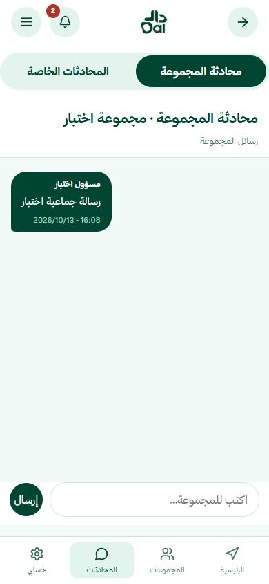
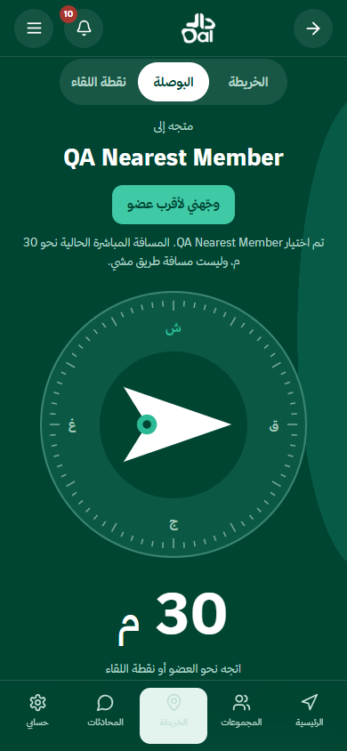
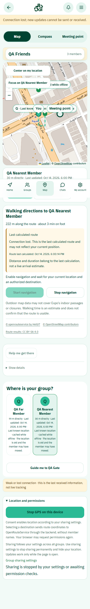
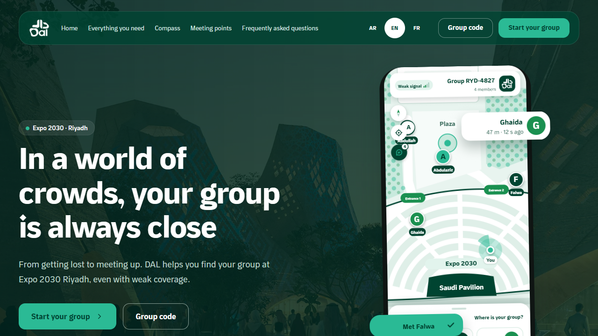

# دال | DAL

### مجموعتك دائمًا قريبة — A smarter way to reunite at Expo 2030 Riyadh

دال هو نموذج أولي (Prototype) لمنصة ويب تساعد زوار إكسبو 2030 الرياض على العودة إلى مجموعاتهم وسط الزحام. يجمع بين مشاركة الموقع بإذن المستخدم، والخريطة التفاعلية، والبوصلة، ومسارات المشي، ونقطة لقاء مشتركة، مع توضيح حالة الاتصال ومدى حداثة المواقع. وتعمل واجهته بالعربية والإنجليزية والفرنسية.

🔗 [تجربة دال مباشرة](https://dal.up.railway.app) · [تصميم دال على Figma](https://www.figma.com/design/N942ctUotKxc4dgpj42rbU/DAL?node-id=18-11988&t=yR8RMq6wb8b8tEud-1)

## ملفات التسليم النهائية

- [عرض المشروع — Hackathon Presentation (PDF)](docs/submission/Dal-Hackathon-presentation.pdf)
- [دراسة الحالة — UX/UI Case Study (PDF)](docs/submission/dal-case_study.pdf)
- [ملف التصميم الأصلي — DAL-final.fig](docs/submission/DAL-final.fig)



## التحدي الذي نعالجه

- البرنامج: تحدي إكسبو 2030 الرياض — برنامج Immersive.
- المسار: 1 — تجربة الزائر الذكية (Smart Visitor Experience).
- التحدي: 1.5 — صعوبة عودة الزائر إلى مجموعته عندما تكون نقطة اللقاء مزدحمة وإشارة الجوال ضعيفة.

بدلًا من الاعتماد على المكالمات وتبادل وصف المواقع يدويًا، يتيح دال لأعضاء المجموعة رؤية آخر موقع متاح لبعضهم، واختيار شخص أو نقطة لقاء والتوجّه نحوه. والهدف تقليل الوقت والارتباك اللازمين للالتقاء وتحسين تجربة الزائر.

## كيف يستخدم الزائر دال؟

1. يسجّل حسابًا وينشئ مجموعة أو ينضم إليها برمز أو رابط/QR.
2. يختار إعدادات مشاركة موقعه، ويفعّل GPS والبوصلة عند الحاجة عبر نافذة أذونات واضحة؛ لا يبدأ التتبع دون موافقته.
3. يعرض مواقع أعضاء المجموعة المصرّح بها على الخريطة مع وقت آخر تحديث، أو يختار أقرب عضو من البوصلة.
4. يحدد عضوًا أو نقطة لقاء، ويتابع الاتجاه والمسافة المباشرة أو يبدأ مسار مشي عند توفر الخدمة.
5. يستخدم المحادثة والتنبيهات وتأكيد الوصول للتنسيق، ويشاهد تنبيهًا واضحًا إذا أصبح الموقع أو المسار قديمًا.
6. يمكنه تغيير لغة الواجهة في أي وقت بين العربية والإنجليزية والفرنسية.

## الوظائف

### Core / MVP

- إنشاء المجموعات والانضمام إليها بالرمز أو الرابط أو QR، وإدارة الأعضاء وصلاحيات الانضمام.
- مشاركة الموقع بإذن صريح مع أوضاع `WHILE_USING` و`SCHEDULED` و`ALWAYS` والتحكم في الإيقاف والاستئناف.
- خريطة تفاعلية تعرض الموقع الحالي والأعضاء المسموح بمشاهدة مواقعهم ونقطة اللقاء، مع تاريخ القراءة ودقة الموقع وحالات انقطاع الاتصال.
- بوصلة لتحديد الاتجاه والمسافة المباشرة إلى عضو أو نقطة لقاء، مع الاستفادة من حساس الجهاز عند توفر قراءة صالحة.
- تحديد نقطة لقاء مشتركة، والتواصل عبر الرسائل والتنبيهات داخل المجموعة.

### ميزات إضافية (Extra)

- زر «وجّهني لأقرب عضو» يختار أقرب عضو يشارك موقعًا صالحًا وحديثًا، دون إرسال طلب مسار مشي تلقائيًا.
- زر توجيه مباشر إلى نقطة اللقاء من شاشة البوصلة، مع بقاء التحكم ببدء المشي منفصلًا.
- مسارات مشي باستخدام OpenRouteService؛ يبقى آخر مسار صالح ظاهرًا أثناء إعادة الحساب، ويتحدث عند الحركة المؤثرة أو بعد عودة الاتصال إذا توفرت البيانات والأذونات.
- مساعد AI لشرح توصيات العودة واقتراحات نقطة اللقاء؛ يبقى الاختيار الأساسي مبنيًا على قواعد وحسابات في Backend، مع بديل واضح عند تعذّر OpenAI.
- محادثة جماعية وخاصة، وتنبيهات مع حالات قراءة، وتأكيد الوصول يدويًا، واستعادة كلمة المرور عبر Brevo عند تهيئته.
- واجهة بالعربية والإنجليزية والفرنسية تشمل الشاشات الداخلية ورسائل النظام ورسومات توضيحية مترجمة؛ مع تبديل فوري بين RTL وLTR.
- نافذة إرشادية مستقلة لتفعيل GPS وحساس البوصلة، وإعادة المحاولة بعد الفشل أو انتهاء مهلة القراءة دون افتراض منح الصلاحيات.
- تحسين تخطيط الجوال والتابلت والكمبيوتر، ووضوح الأزرار والتنقل السفلي وحالات التحميل والخطأ والنجاح.

### ماذا يحدث عند ضعف أو انقطاع الاتصال؟

دال لا يوفّر تتبعًا حيًا أو إرسال رسائل دون إنترنت. عند فقد الاتصال قد تبقى آخر مواقع الأعضاء المصرّح بها ونقطة اللقاء وآخر مسار مشي محسوب داخل ذاكرة الصفحة؛ تظهر بوسم «آخر موقع/مسار معروف» مع بيان قدم البيانات، ولا تُعرض مدة المشي القديمة على أنها وصول مباشر حي. تُزال البيانات المنتهية أو غير المسموح بها، وتُعاد مراجعة الصلاحيات وحداثة المواقع عند عودة الاتصال. لا تُفترض إتاحة خرائط جديدة أو إجراء مزامنة خلفية دون اتصال.

## التقنيات المستخدمة

| الطبقة | التقنية |
| --- | --- |
| Frontend | React 18, Vite 6, JavaScript, CSS، وتنسيقات متجاوبة للجوال والتابلت والكمبيوتر |
| Maps & Navigation | React Leaflet, Leaflet, OpenStreetMap, Geolocation وDevice Orientation APIs، وحساب Haversine وBearing |
| Localization | Arabic / English / French عبر قواميس ترجمة وReact Context، مع RTL/LTR ورسومات متعددة اللغات | 
| Backend | Java 17, Spring Boot 4.1.1, Spring Web, Spring Data JPA, Spring Security |
| Database | MySQL |
| Authentication & Security | HttpSession, CSRF protection, BCrypt, input validation, access controls |
| Walking Directions | OpenRouteService API (اختياري ويحتاج مفتاحًا) |
| AI Explanation | OpenAI Responses API (اختياري، مع بديل حسابي عند عدم توفره) |
| Email | Brevo API (عند التهيئة) |
| Deployment | Railway, Docker |

## بنية المستودع

```text
Dal/
├── frontend/                # React + Vite + واجهات الخريطة والبوصلة والمحادثات
│   ├── src/                   # الواجهات، الترجمة، Hooks، الخرائط والحساسات
│   ├── public/assets/         # رسومات الهوية ونسخ اللغات
│   ├── tests/                 # اختبارات Frontend
│   └── Dockerfile
├── backend/                 # Spring Boot REST API
│   ├── src/main/java/com/example/dal/
│   │   ├── Controller/
│   │   ├── Service/
│   │   ├── Repository/
│   │   ├── Model/
│   │   ├── DtoIn/
│   │   ├── DtoOut/
│   │   └── Config/
│   ├── src/test/
│   ├── migrations/
│   └── Dockerfile
├── docs/                    # تقارير التحقق والصور وملفات التسليم
│   └── submission/           # ملفات Figma ودراسة الحالة والعرض النهائي
├── RAILWAY_SETUP.md
└── README.md
```

الواجهة تطلب `/api/v1` عبر Reverse Proxy من نفس نطاق الموقع. يحتفظ Backend بالجلسة ويتحقق من CSRF والصلاحيات؛ لا توضع مفاتيح خدمات الطرف الثالث في React.

## أمثلة من API

كل المسارات التالية تحت `/api/v1` وتتطلب الجلسة/الصلاحيات المناسبة، وعمليات التعديل تستخدم CSRF:

| Method | Endpoint | الوظيفة |
| --- | --- | --- |
| `GET` | `/security/csrf` | الحصول على CSRF token |
| `POST` | `/navigation/group/{groupId}/walking` | حساب مسار مشي للعضو أو نقطة اللقاء |
| `POST` | `/navigation/group/{groupId}/reunion-assistance` | مساعدة اللقاء وشرح التوصية |
| `POST` | `/navigation/group/{groupId}/meeting-suggestions` | مقارنة مواقع اللقاء المقترحة |
| `GET` | `/notification/unread-count` | عدد التنبيهات غير المقروءة |
| `POST` | `/group-message/group/{groupId}` | إرسال رسالة للمجموعة |
| `GET` | `/group-message/group/{groupId}` | قراءة رسائل المجموعة |

## الاختبارات والتحقق

```bash
# Frontend (داخل frontend/)
npm test
npm run build

# Backend (داخل backend/ على Windows)
.\mvnw.cmd test
```

- آخر نتيجة موثقة للـ Frontend بتاريخ 15 أكتوبر 2026: **172 اختبارًا ناجحًا** دون فشل، مع نجاح Build. راجع [تقرير GPS والبوصلة على iPhone](docs/IOS_PERMISSION_RETRY_FIX.md).
- آخر نتيجة موثقة لاختبارات Backend ضمن تحديث دورة حياة مشاركة الموقع: **79 اختبارًا ناجحًا واختبار MySQL اختياري واحد متجاوز**؛ راجع [التقرير التقني](docs/ISSUE_07_LOCATION_SHARING_LIFECYCLE.md).
- شملت فحوص الواجهة Chrome وWebKit، واللغات الثلاث، وأحجام جوال وتابلت وكمبيوتر متعددة، باستخدام بيانات وأذونات اصطناعية. هذه نتائج موثقة من دورات تطوير سابقة، وليست إعادة تشغيل للاختبارات أثناء تحديث README.
- **لم يثبت التقرير اختبار حساس GPS أو البوصلة على iPhone فعلي**؛ ويلزم التحقق من أذونات Safari والحساسات والتمرير على الجهاز قبل الاعتماد الميداني.

## سيناريو عرض سريع أمام المحكّمين

1. افتح [دال](https://dal.up.railway.app) من جهازين أو متصفحين بحسابين مختلفين.
2. أنشئ مجموعة وشارك رمزها أو QR، ثم انضم من الجهاز الثاني.
3. فعّل مشاركة الموقع من شاشة الأذونات، واعرض مواقع الأعضاء على الخريطة.
4. افتح البوصلة واختر «وجّهني لأقرب عضو» أو «وجّهني إلى نقطة الالتقاء».
5. ابدأ مسار المشي عندما تتوفر بيانات المواقع وخدمة الطرق، واعرض حالة التحديث.
6. اعرض المحادثة أو التنبيه ثم بدّل لغة الواجهة إلى الإنجليزية أو الفرنسية.
7. اشرح أن المسار المحفوظ عند ضعف الاتصال ليس توجيهًا حيًا، وأن الإذن وحداثة الموقع يحددان ما يمكن عرضه.

## حدود النموذج الأولي

- مزامنة المواقع والرسائل تتطلب الإنترنت؛ لا تتوفر شبكة مباشرة بين الأجهزة أو رسائل غير متصلة تُرسل تلقائيًا لاحقًا.
- تتأثر دقة GPS والبوصلة بالجهاز والمتصفح والأذونات والبيئة، ولا يجوز افتراض نجاح حساس iPhone بناءً على اختبارات WebKit المكتبية.
- المسار المحفوظ عند فقد الشبكة مرجع سابق وليس إرشاد مشي مباشرًا أو وقت وصول حيًا؛ وقد لا تظهر خرائط غير مخزنة مؤقتًا.
- يخضع عرض مواقع الأعضاء للصلاحيات وفترات المشاركة وحداثة القراءة، مع إعادة التحقق عند استعادة الاتصال.
- خرائط OpenStreetMap وطرق المشي الخارجية ليست خرائط رسمية لممرات إكسبو الداخلية أو الازدحام والسلامة الفعلية.
- تعتمد ميزات ORS وOpenAI وBrevo على إعدادات مزوديها؛ كما قد تبقى الشروح الحرة المولدة بالـ AI بلغتها الأصلية.
- هذا نموذج أولي لإثبات الفكرة، وليس نظام ملاحة أو سلامة ميدانيًا معتمدًا.

## الأثر المتوقع

يساعد دال على تقليل الارتباك عند انفصال الزوار عن مجموعاتهم، وتبسيط الوصول إلى نقطة اللقاء، وإعطاء الزائر معلومات واضحة عن مواقع الأعضاء ومدى حداثتها، بما يخدم تجربة الزائر الذكية في إكسبو 2030 الرياض.

## ملفات توثيق إضافية

- [توثيق قاعدة بيانات محادثة المجموعة](backend/migrations/README.md)
- [نتائج التحقق الآلي](docs/final-validation.json)

### لقطات من النموذج

| التوجيه بالمشي | اقتراح نقطة اللقاء | المحادثة الجماعية |
| --- | --- | --- |
|  |  |  |

| أقرب عضو في البوصلة | آخر مسار عند ضعف الاتصال | نموذج من الواجهة الإنجليزية |
| --- | --- | --- |
|  |  |  |

*صور الميزات الجديدة التُقطت أثناء مراجعات واجهة باستخدام بيانات اختبارية؛ لا تمثّل اختبار GPS على أجهزة فعلية.*

---

دال — Expo 2030 Riyadh Challenge · Prototype for challenge 1.5 (Smart Visitor Experience).
