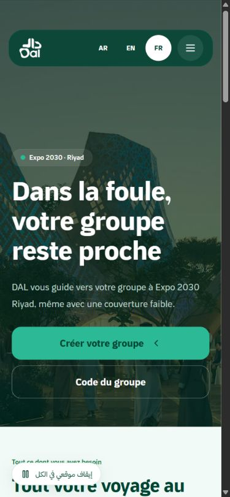
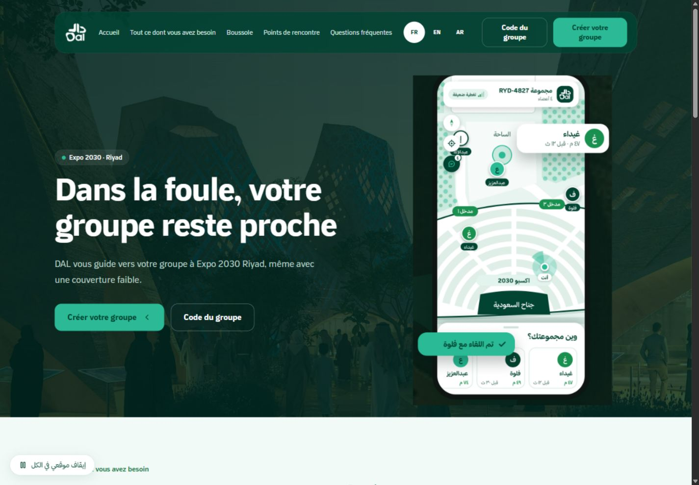
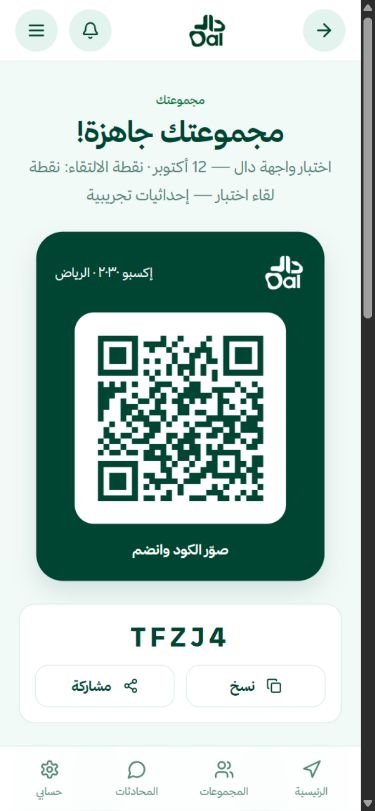
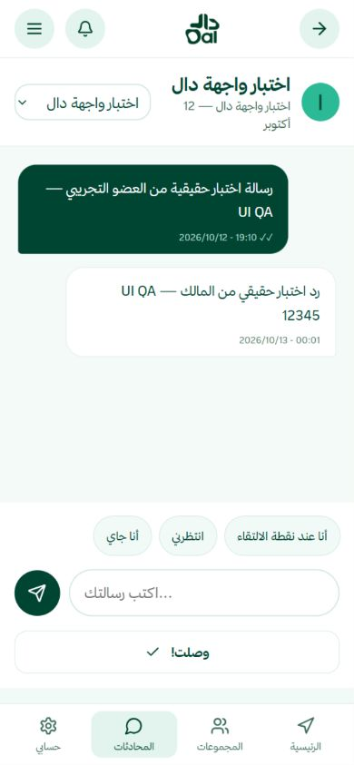
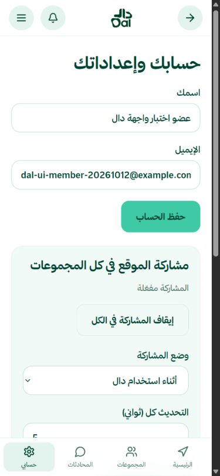
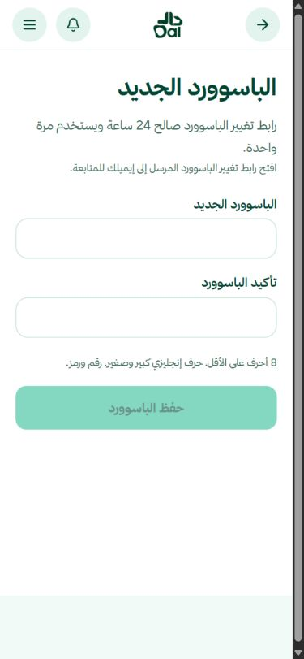
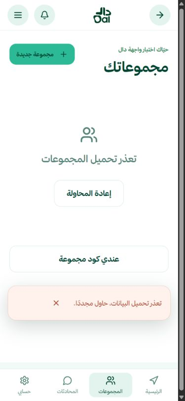

# مراجعة واجهة دال — 13 أكتوبر 2026

أُجريت المراجعة محليًا؛ لا يتضمن هذا التقرير تحققًا من نشر التعديلات إلى Railway. لم يُعدّل Backend أو إعدادات النشر في المستودع. اقتصر إنشاء البيانات الحقيقية على حسابَي الاختبار الموافق عليهما ومجموعة TFZJ4؛ لم تُعدّل بيانات المستخدمين الآخرين.

## المرجع والنطاق

قُرئ AGENTS.md وهيكل المشروع والكود قبل التعديل. المرجع المرئي DAL.pdf وملف هوية دال والخطوط المرفقة. شملت المقارنة الرئيسية للجوال والكمبيوتر، القائمة، المجموعات، الإنشاء والانضمام وQR، الخريطة، البوصلة والمحادثة. الصفحات المرجعية الأساسية: 1، 2، 4، 11، 41، 42، 53، 54، 58، 76. بقية الصفحات تتضمن حالات ونسخ لغوية متكررة؛ لا يُدّعى تطابق كل بكسل في الصفحات الـ198.

لا توجد مراجع مستقلة للدخول والاستعادة والإعدادات حسب تأكيد المستخدم؛ حُفظ تصميمها الحالي مع تصحيح الاستخدام. ملفات الخطوط الخمسة مطابقة لملفات ZIP المرفق بحسب SHA256. بقيت ألوان الهوية الأساسية #004432 و#1b9151 و#2bba95 و#e3f4ee؛ غُمّق لون النص الثانوي لتحسين القراءة.

## الإصلاحات

- إزالة الزوايا البيضاء أعلى الرئيسية على الجوال، وتثبيت أزرار اللغات على 44×44 بكسل دون ضغط أفقي؛ زر اللغة المختارة دائري الآن. قياس المتصفح أكد تساوي العرض والارتفاع.
- معالجة تزاحم التنقل على التابلت، التفاف أسماء الأعضاء والنصوص، انكماش عناصر Flex/Grid، ومواضع الأزرار. ضبط عنوان الرئيسية على الكمبيوتر، بطاقة QR الداكنة وتخطيط المشاركة وفق المرجع.
- تحسين تباين النص الثانوي والزر داخل القسم الأخضر، ومساحات اللمس، واتجاه الإيميلات والأرقام والحقول الإنجليزية. الواجهات التشغيلية عربية وRTL؛ الرئيسية تدعم AR/EN/FR.
- جعل النوافذ قابلة للتمرير داخل الشاشة، وحبس التركيز داخلها وإعادته عند الإغلاق، ودعم Escape ومنع تمرير الخلفية. تحسين المساحة أسفل شريط التنقل وموضع كتابة الرسائل في نافذة قصيرة.
- فصل حالات التحميل والخطأ والفراغ للمجموعات والإشعارات والمحادثة، وإضافة إعادة المحاولة. إزالة الخطأ القديم عند تبديل المستلم أو تبويب الدخول، ومنع تكرار الإرسال أثناء الطلب.
- معالجة انتهاء الجلسة الذي يعيده Backend برمز 400، ورسائل CORS وتعذر الشبكة، وتعريب الأخطاء المعروفة دون تعديل نصوص المستخدمين.
- حفظ تاريخ المحادثة المحمّل عند التحديث الدوري، وتجاهل استجابة مستلم قديم بعد تبديله. تحديث حالة القراءة دون تكرار الرسائل.
- تصحيح إعادة عرض مواعيد المشاركة المحفوظة والتحقق من ترتيب البداية والنهاية. مطابقة شروط الباسوورد مع Backend، بما فيها الرموز Unicode وحد 72 بايت UTF-8.
- توضيح غياب رمز استعادة الباسوورد وتعطيل الحفظ حين يغيب؛ تنظيف مسار الاستعادة عند الرجوع للرئيسية حتى لا تُفتح الاستعادة مجددًا بعد تحديث الصفحة. لم يُغيّر باسوورد أي حساب.

## مشكلة الاتصال 404

العنوان السابق dal-backend-production.up.railway.app أعاد HTML 404 لمسارات API الموجودة في الكود. العنوان الصحيح https://dal-backend.up.railway.app أعاد JSON 200 لمسار /api/v1/security/csrf. كلا إعدادَي proxy، في Vite وفي خادم الإنتاج، يمرّران /api/v1 دون حذف البادئة؛ لم تكن المشكلة في أسماء Endpoint.

بعد تصحيح العنوان ظهر رفض Origin محلي بـ403. أضاف المستخدم http://127.0.0.1:5176 إلى FRONTEND_ORIGINS وأعاد النشر. تحقق السماح بهذا Origin، ثم اختُبرت نسخة build المحلية مع خادم الإنتاج والـproxy إلى Backend الحقيقي. لم تُعطّل حماية CSRF أو Cookies أو CORS.

## الاختبارات الحقيقية

| الوظيفة | النتيجة وحدود الدليل |
|---|---|
| التسجيل والدخول والخروج | نجحت للحسابين الوهميين؛ استمرت الجلسة والبيانات بعد التحديث |
| إنشاء المجموعة ونقطة اللقاء | نجحت مجموعة TFZJ4، وحُفظت نقطة اللقاء التجريبية واستُرجعت |
| مواعيد المشاركة | نجح الحفظ وإعادة العرض؛ اختُبر رفض الجدولة الناقصة، ثم أعيد الوضع أثناء الاستخدام |
| إضافة الحساب الثاني | سبق إنشاؤه وانضمامه إلى TFZJ4؛ لم يُكرر الحساب أو الانضمام في الاستئناف |
| الرسائل والتنبيهات والوصول | نجحت العمليات بين الحسابين فقط. ظهرت رسالة العضو ورد المالك في المتصفح، واستُرجعت التنبيهات، ونجح تحديث القراءة |
| صلاحيات الواجهة | ظهرت أدوات المالك له وغابت عن العضو العادي؛ هذا فحص عرض، وليس إثباتًا شاملًا لأمان الصلاحيات |
| الحساب | نجح PUT /api/v1/user/profile للحساب الوهمي الثاني بالبيانات الحالية، دون تغيير بيانات أشخاص آخرين |
| كود المجموعة | نسخ TFZJ4 بنجاح؛ الكود القصير مُنع محليًا، وكود اختبار غير صالح أعاد 400 ورسالة واضحة |
| طلب استعادة الباسوورد | أعاد 200 لإيميل تجريبي غير مسجل. هذا يثبت الطلب والرسالة الموحدة فقط؛ لا يثبت إرسال الإيميل أو وصوله أو تغيير الباسوورد |

الحسابان: «اختبار واجهة دال» و«عضو اختبار واجهة دال». الإحداثيات ومواعيد المشاركة بيانات اختبار وهمية. الأدلة المنقحة في [طلبات المتصفح عبر proxy](network.jsonl) و[طلبات إنشاء العضو والانضمام والإرسال](real-api-results.json). تتضمن الطريقة والمسار والنتيجة فقط، دون Cookies أو Tokens أو كلمات مرور. هذه ليست HAR كاملًا لكل طلب شبكة.

## المقاسات والحالات

فُحصت الرئيسية باللغات الثلاث، المجموعات وتفاصيلها، الإنشاء والانضمام والتسجيل والاستعادة والإعدادات، القائمة ونافذة التأكيد، المحادثة والإشعارات ومعاينات الخريطة والبوصلة على 360×800 و390×844 و430×932 و768×1024 و1440×1000. سجلات [قياس الواجهة](viewport-checks.json) تستبعد المحاولات التي لم يطابق فيها العرض الفعلي المقاس المطلوب. لم تُرصد زيادة عرض الصفحة أو تجاوز العناصر المقاسة. فحص الدخول النهائي المسجل يغطي 360 و390 و430 و768؛ فحص الكمبيوتر له كان في مرحلة سابقة من المراجعة ولم يُعاد توثيقه في الجولة النهائية.

اختُبرت حالات تأخر الطلب و503 وإعادة المحاولة والبيانات الفارغة والأسماء الطويلة بخادم fixture محلي منفصل. هذه أدلة على سلوك الواجهة، ولا تُحسب دليلًا على نجاح الربط الحقيقي. اختُبرت حالات الخطأ الممكنة بأمان على Backend، مثل كود المجموعة غير الصالح.

فُحصت مساحة كتابة الرسائل عند ارتفاع نافذة 420 بكسل مع التركيز على الحقل؛ هذه محاكاة تقلص المساحة وليست اختبار لوحة مفاتيح جوال حقيقي. لا توجد أخطاء أو تحذيرات في Console النهائي المسجل: [السجل](console-final.json).

نجح npm run build وnpm test: **14 اختبارًا، صفر فشل**. تشمل الاختبارات الجلسة وCSRF والـproxy ومعالجة الأخطاء والباسوورد والتواريخ وتحديث المحادثة. نجح git diff --check. لم تظهر كلمات مرور الاختبار أو أسرار Backend في src أو public أو review.

## الملفات المعدلة

| الملف | الغرض |
|---|---|
| src/style.css | المقاسات والتباين وRTL وبطاقة QR والدائرة والزاوية |
| src/main.jsx | حالات الطلبات والنماذج والمحادثة والاستعادة والنصوص |
| src/Dialog.jsx | إدارة النوافذ والتركيز والتمرير |
| src/api.js | رسائل الاتصال والجلسة وأخطاء Backend |
| src/utils.js | شروط الباسوورد والتواريخ والإشعارات ودمج المحادثة |
| index.html | إعداد viewport للهواتف |
| tests/api.test.mjs، tests/utils.test.mjs | اختبارات التصحيحات |
| tests/manual-api-fixture.mjs | حالات الفشل المحلية المنضبطة، خارج تشغيل الإنتاج |
| README.md، review/ | توثيق الاختبار وأدلته ولقطاته |

## فروق وحدود متبقية

- الخريطة والبوصلة والكاميرا في المشروع معاينات تصميم موجودة مسبقًا؛ لا يوجد دليل نجاح GPS أو الحساسات أو تتبع حي. تحويلها إلى وظائف فعلية يتجاوز إصلاح الشكل الحالي.
- المرجع يتضمن الانضمام دون حساب ورموزًا مثل RYD4827، بينما Backend الحالي يتطلب جلسة ويستخدم رمزًا من 5 أحرف أو أرقام. لم تُغيّر هذه العقود؛ المطابقة هنا تستلزم توسيع النطاق إلى Backend أولًا.
- اختيار نقاط اللقاء بصريًا أثناء الإنشاء في المرجع مختلف عن نموذج الإحداثيات الحالي بعد إنشاء المجموعة. بقي التدفق الحالي العامل.
- المحادثة الحالية مباشرة بين عضوين؛ المحادثة الجماعية ومرفقات الموقع وصف الإرسال دون اتصال في المرجع غير منفذة. لم تُضف ميزات جديدة.
- قص الصور وتكوين صورة الهاتف والزخارف ليست مطابقة بكسلية كاملة للمرجع. الصفحات التشغيلية ما زالت عربية حتى عند تغيير لغة الرئيسية.
- لم تُختبر خدمة البريد بإيميل يستقبل الرسائل أو رابط استعادة صالح، ولا لوحة مفاتيح وأجهزة جوال فعلية أو مشاركة النظام أو الكاميرا. لا تُعد هذه الوظائف ناجحة دون اختبار.
- لم تُنفذ إجراءات نقل الملكية أو إزالة الأعضاء أو إغلاق المجموعة أو حذف سجل المواقع أو توسيع الصلاحيات على Backend الحقيقي. لم تتأثر بيانات المستخدمين الآخرين.

## لقطات النتيجة

